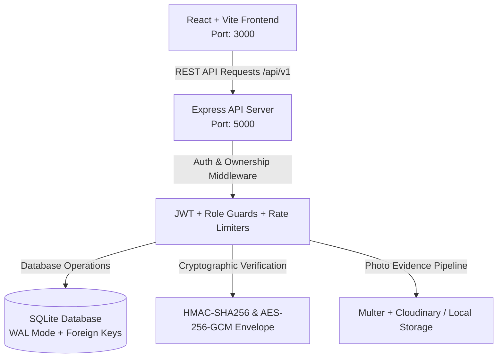

# SevaConnect — Full-Stack Architecture & Security Blueprint

## 1. System Overview
SevaConnect is a production-oriented local service marketplace engineered for Indian urban households and background-verified service professionals.

The architecture strictly decouples frontend presentation and client state from backend authorization, database persistence, and cryptographic verification.



---

## 2. Dual-Code OTP Verification Protocol

To prevent fraudulent booking completions and protect both customer and provider:

1. **Generation**:
   - Two independent 6-digit numeric codes are generated cryptographically when a booking is created (`crypto.randomInt(100000, 1000000)`).
   - Stored in SQLite as HMAC-SHA256 hashes (`start_code_hash`, `end_code_hash`).
   - Plaintext values are never stored in database columns or server logs.
   - For authorized customer retrieval, codes are packaged in an AES-256-GCM encrypted envelope using `CODE_ENCRYPTION_KEY`.

2. **Starting Code Verification**:
   - Customer reveals the Starting Code upon technician arrival at the doorstep.
   - Provider enters the code via `/api/v1/bookings/:id/verify-start-code`.
   - Timing-safe comparison via `crypto.timingSafeEqual`.
   - Transitions booking status atomically from `confirmed` to `in_progress`.
   - Sets `service_started_at`.
   - Before-service photographs can be uploaded as evidence before/during start.

3. **Ending Code Verification**:
   - Customer only provides the Ending Code after work is finished, tested, and premises cleaned.
   - Provider enters the code via `/api/v1/bookings/:id/verify-end-code`.
   - Enforces that booking is already `in_progress` (Ending Code can NEVER complete a job before Starting Code is verified).
   - Transitions booking status atomically from `in_progress` to `completed`.
   - Sets `service_completed_at`, marks `payment_status = 'PAID'`, and credits earnings to the provider's wallet.

---

## 3. Before & After Service Photographic Evidence Pipeline

- **Before-Service Photos**: Captured by the provider on doorstep arrival. Uploaded to `/api/v1/bookings/:id/photos/before`.
- **After-Service Photos**: Captured by the provider upon finishing repairs. Uploaded to `/api/v1/bookings/:id/photos/after`.
- **Storage**: Cloudinary in production (with automatic local disk fallback in development).
- **Access Control**: Visible only to the authorized customer, assigned provider, and platform admin in booking details.

---

## 4. Zero Seeded Data Guarantee
- The application starts with zero seeded users, providers, bookings, reviews, or fake statistics.
- System service categories (Electrician, Plumber, etc.) are provisioned as required system taxonomy.
- Admins are provisioned strictly via the secure CLI command:
  ```bash
  npm run create-admin -- --name "Admin Name" --email "admin@sevaconnect.in" --password "StrongPass123!"
  ```
