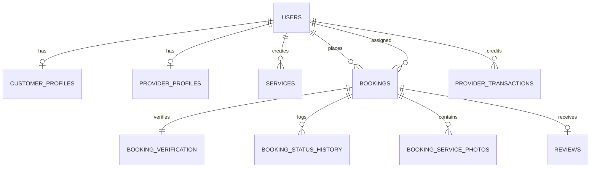

# SevaConnect Database Schema Specification

## Engine
- **Database Engine**: SQLite 3 with WAL mode enabled (`PRAGMA journal_mode = WAL;`) and Foreign Key enforcement (`PRAGMA foreign_keys = ON;`).
- **Currency Convention**: Monetary values stored as integer paise (1 Rupee = 100 paise) to prevent floating-point calculation errors.
- **Timestamps**: ISO 8601 UTC strings (`YYYY-MM-DDTHH:mm:ss.sssZ`).

---

## Entity Relational Diagram

---

## Tables Summary

1. `users`: Stores core credentials, role (`customer`, `provider`, `admin`), phone, address, and profile avatar.
2. `customer_profiles`: Extended customer information and emergency contacts.
3. `provider_profiles`: Business details, hourly rates, KYC verification status, and calculated review averages.
4. `service_categories`: System category configuration (Electrician, Plumbing, AC Repair, Cleaning, etc.).
5. `services`: Specific service offerings managed by service providers.
6. `bookings`: Complete booking records with server-calculated price paise, scheduled times, addresses, and state.
7. `booking_verification`: HMAC-SHA256 hashes and AES-256-GCM encrypted envelopes for Starting and Ending OTP codes.
8. `booking_service_photos`: Photographic evidence records for `before` and `after` stages.
9. `reviews`: Customer ratings and feedback linked to completed bookings.
10. `provider_transactions`: Financial ledger records for wallet credit and payouts.
11. `complaints`: Dispute and complaint tracking tickets.
12. `audit_logs`: Audit trail for sensitive operations.
