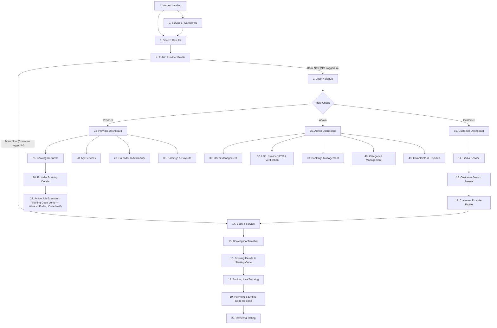

# SevaConnect Frontend Architecture & Connection Specification

## 1. System Overview
SevaConnect is a production-grade local services marketplace engineered specifically for Indian urban and semi-urban households (starting with NCR hubs such as Faridabad, Gurugram, Noida, and South Delhi).

The application is structured into four distinct functional portals:
1. **Public Website**: For visitors, home service discovery, provider directory, informational pages, and authentication.
2. **Customer Portal**: For registered customers to schedule services, track live technician status, securely manage Starting & Ending verification codes, make payments, and manage service addresses.
3. **Service Provider Portal**: For verified local professionals to manage job requests, view customer locations, execute jobs via Dual-Code OTP verification, manage calendars, service offerings, and track bank payouts.
4. **Admin Portal**: For platform operators to review provider KYC documentation, moderate reviews, manage commission rates, oversee platform bookings, and resolve customer complaints.

---

## 2. Navigation & Page Connection Map (Flowchart Alignment)



---

## 3. Dual-Code Verification Protocol

To prevent fraudulent job completions and safeguard both customer and service technician:
1. **Starting Code (4-digit OTP)**:
   - Generated by server upon booking confirmation.
   - Accessible ONLY inside the customer's secure booking detail view.
   - The provider arrives at the customer's location, inspects the issue, and asks the customer for the Starting Code.
   - The provider submits the Starting Code via the Provider Portal to transition the booking status to `STARTED`.
2. **Ending Code (4-digit OTP)**:
   - Generated alongside booking creation.
   - Displayed with a critical alert: *"Never share your Ending Code before the service has been completed to your satisfaction."*
   - Once all work and cleanup is completed, the customer hands over the Ending Code.
   - Provider enters the Ending Code to transition the booking to `COMPLETED` and trigger payment settlement.

---

## 4. Color Palette & Design Tokens

| Token | Hex | Role |
|---|---|---|
| `primary` | `#087443` | Primary brand green (trust, vitality, verified) |
| `primary-hover` | `#065f36` | Active/Hover primary state |
| `primary-light` | `#F1F8F4` | Tinted background for badges, active tabs, highlights |
| `text-dark` | `#101828` | Main headings and primary body text |
| `text-muted` | `#667085` | Subtitles, helper text, and icons |
| `border-default` | `#E5E7EB` | Hairline card and table borders |
| `bg-main` | `#FFFFFF` | Card backgrounds and primary surface |
| `bg-muted` | `#F8FAFC` | Page backgrounds, sidebar, and table striping |
| `badge-success` | `#027A48` | Completed, Verified, Active status |
| `badge-warning` | `#B54708` | Pending, In Progress, On The Way |
| `badge-error` | `#B42318` | Cancelled, Rejected, Suspended |

---

## 5. Directory Blueprint

```text
frontend/
├── public/
│   ├── favicon.svg
│   └── logo.svg
├── src/
│   ├── assets/
│   │   └── images/
│   ├── components/
│   │   ├── common/
│   │   ├── navigation/
│   │   ├── public/
│   │   ├── customer/
│   │   ├── provider/
│   │   └── admin/
│   ├── layouts/
│   ├── pages/
│   │   ├── public/
│   │   ├── auth/
│   │   ├── customer/
│   │   ├── provider/
│   │   ├── admin/
│   │   └── NotFoundPage.jsx
│   ├── routes/
│   ├── services/
│   ├── context/
│   ├── hooks/
│   ├── utils/
│   ├── constants/
│   ├── styles/
│   ├── App.jsx
│   ├── main.jsx
│   └── index.css
```
